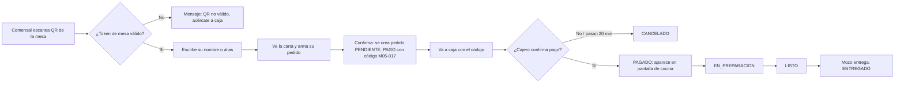
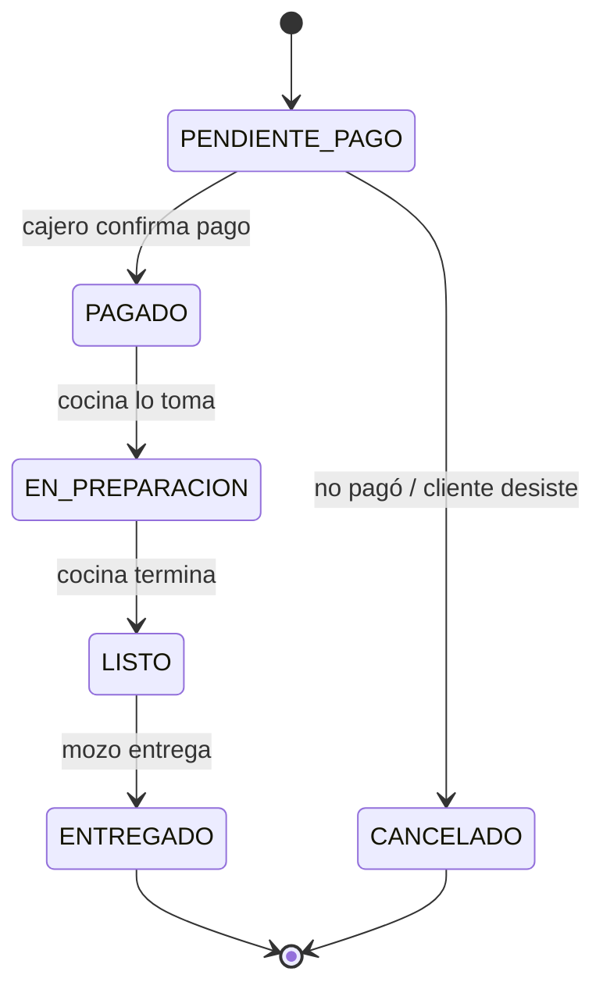

# Idea del sistema y mejoras propuestas

## La idea en una línea

El cliente escanea el QR de su mesa → ve la carta → pide con su nombre → paga en caja → recién ahí el pedido pasa a cocina.

Resuelve el cuello de botella real: **tomar el pedido** es lo que más tiempo de mozo consume. Con el QR, el mozo solo **entrega**, y un mismo número de mozos atiende más mesas.

## Flujo del pedido

## Estados del pedido (los que protege el trigger)

Cualquier otro salto (por ejemplo `PENDIENTE_PAGO → EN_PREPARACION`) lo **rechaza la base de datos**.

## Mi opinión: qué le agregué o mejoré a la idea

Estas mejoras ya están metidas en el contrato; si el equipo no las quiere, se quitan ahí con un ADR.

1. **Pagar antes de cocinar es la mejor decisión de la idea, y hay que defenderla así.** Como nada se prepara sin pago, un pedido falso (alguien que pide desde fuera o por broma) no cuesta nada: se queda en `PENDIENTE_PAGO` y se cancela. Eso permite que el QR sea simple y que no haga falta que un mozo "abra" la mesa. Es un argumento fuerte para Seguridad (IX) y para la justificación gerencial.
2. **El QR lleva un token, no el número de mesa.** En vez de `.../mesa/5` (que cualquiera puede cambiar a `/mesa/6`), el QR lleva un código aleatorio (`token_qr`). Si alguien copia el enlace, el administrador regenera el QR de esa mesa.
3. **"Quién pide" = nombre o alias, nada más.** No se pide DNI ni celular. Cumple el principio de mínimo dato de la Ley 29733 (sección XVIII en la Unidad 2) y no espanta al cliente.
4. **Cada comensal tiene su propio pedido dentro de la mesa.** Así, en un grupo de amigos cada uno paga lo suyo en caja ("cuenta dividida" sin esfuerzo). La `sesion_mesa` agrupa a todos los de esa visita.
5. **Código corto y legible** (`M05-017` = mesa 5, pedido 17 del día) para que el cajero lo encuentre rápido aunque haya cola.
6. **Pantalla de cocina** en vez de comandas de papel: cocina ve solo lo pagado, en orden de llegada.
7. **Botón "agotado"**: cocina apaga un producto y desaparece de la carta al instante; se evita que el cliente pague algo que no hay.
8. **Plan B sin celular:** el cliente que no tiene celular o datos sigue pidiendo en caja como siempre. Va en *Supuestos* (sección III).

### Cosas que dejé fuera a propósito (para no enredarnos en el 50 %)
- Pago en línea dentro de la web → es justo lo que pide la sección XII en la **Unidad 2**; ahí entra con pasarela en modo sandbox.
- Reservas de mesa, delivery, fidelización → fuera de alcance (se declaran en *Limitaciones*).
- App nativa → es web responsive; no se instala nada.

## Lo que esta idea le regala a la Unidad 2

Ver Unidad 2 - lo que viene: el mismo sistema crece a pago en línea (XII), Odoo con inventario de insumos (XIII), tablero BI de ventas por hora/producto (XIV) y un asistente IA de la carta (XV), sin cambiar de proyecto.
