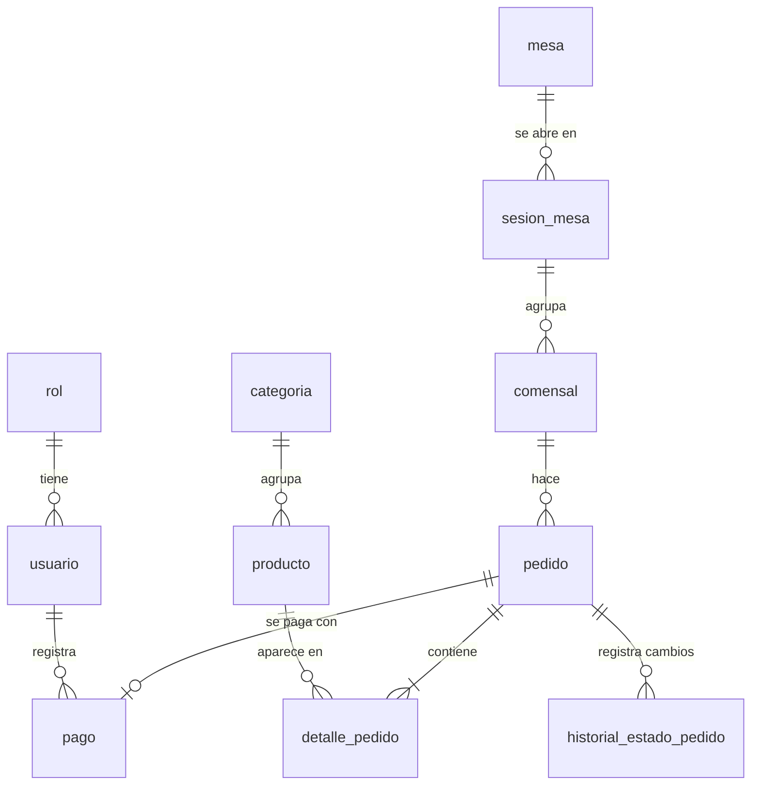

# Iván — Base de datos

**Rol:** Responsable de base de datos
**Sección:** VIII (Diseño de base de datos) + filas de BD del ADR
**Expone:** modelo ER, normalización, diccionario de datos y trigger

Antes de empezar: Contrato del equipo (fuente única de verdad)

---

## ✅ Qué debes hacer

### A. Modelo entidad-relación normalizado (hasta 3FN)
Parte de este borrador (las tablas y estados son los del contrato). Tú decides tipos, campos extra, restricciones y lo dibujas bien en draw.io → `docs/diagramas/er-chispaqr.png`.



- [ ] Explicar la normalización paso a paso: 1FN → 2FN → 3FN con un ejemplo (por ejemplo, partir de la "comanda en papel" con todo junto).
- [ ] Defender dos decisiones que el docente suele preguntar:
  - **`detalle_pedido.precio_unitario` no es redundancia:** guarda el precio **del momento de la venta**; si mañana sube el precio en `producto`, los pedidos pasados no cambian.
  - **`pedido.total`:** o se calcula con una vista (`vw_pedido_total`) o se guarda y se justifica como dato consolidado de la venta. Elige uno y explícalo.

### B. Diccionario de datos
- [ ] Tabla por cada tabla: campo, tipo (PostgreSQL), nulo sí/no, PK, FK (a qué tabla), descripción, restricción (`CHECK`, `UNIQUE`, `DEFAULT`).
- [ ] Los `CHECK` de estados con **exactamente** los valores del contrato (`PENDIENTE_PAGO`, `PAGADO`, …).
- [ ] `mesa.token_qr` y `pedido.codigo_pedido` con `UNIQUE`.
- [ ] `usuario.contrasena_hash` (nunca la contraseña en texto).
- [ ] De `comensal` solo `nombre_alias` + fecha + FK a la sesión (nada de DNI ni celular → RNF-05).

### C. Trigger (al menos uno — este es el principal)
`trg_pedido_cambio_estado`: antes de actualizar `pedido.estado`, valida la transición y registra el cambio en `historial_estado_pedido`. Transiciones permitidas:

| De | A |
|---|---|
| `PENDIENTE_PAGO` | `PAGADO`, `CANCELADO` |
| `PAGADO` | `EN_PREPARACION` |
| `EN_PREPARACION` | `LISTO` |
| `LISTO` | `ENTREGADO` |

Borrador para que partas (lo ajustas y pruebas tú):

```sql
CREATE OR REPLACE FUNCTION fn_pedido_cambio_estado()
RETURNS trigger AS $$
BEGIN
  IF NEW.estado = OLD.estado THEN
    RETURN NEW;
  END IF;

  IF NOT (
       (OLD.estado = 'PENDIENTE_PAGO' AND NEW.estado IN ('PAGADO', 'CANCELADO'))
    OR (OLD.estado = 'PAGADO'         AND NEW.estado = 'EN_PREPARACION')
    OR (OLD.estado = 'EN_PREPARACION' AND NEW.estado = 'LISTO')
    OR (OLD.estado = 'LISTO'          AND NEW.estado = 'ENTREGADO')
  ) THEN
    RAISE EXCEPTION 'Transición no permitida: % -> %', OLD.estado, NEW.estado;
  END IF;

  -- No se marca PAGADO si no existe el registro en pago
  IF NEW.estado = 'PAGADO'
     AND NOT EXISTS (SELECT 1 FROM pago WHERE id_pedido = NEW.id_pedido) THEN
    RAISE EXCEPTION 'El pedido % no tiene pago registrado', NEW.codigo_pedido;
  END IF;

  INSERT INTO historial_estado_pedido (id_pedido, estado_anterior, estado_nuevo, fecha_cambio)
  VALUES (NEW.id_pedido, OLD.estado, NEW.estado, now());

  RETURN NEW;
END;
$$ LANGUAGE plpgsql;

CREATE TRIGGER trg_pedido_cambio_estado
BEFORE UPDATE OF estado ON pedido
FOR EACH ROW EXECUTE FUNCTION fn_pedido_cambio_estado();
```

- [ ] **Justificación gerencial del trigger:** protege la regla de negocio más importante del recreo — **no se cocina lo que no se pagó** — aunque alguien se equivoque en la app o entre directo a la base de datos; y deja un historial para resolver reclamos ("yo pagué y no me llegó").
- [ ] **Justificación gerencial de la normalización:** evita precios distintos para el mismo plato, pedidos "huérfanos" sin mesa y cobros mal calculados.
- [ ] *(Opcional, suma)* Segundo trigger: al marcar `PAGADO`, descontar `producto.stock` de las bebidas embotelladas y poner `disponible = false` cuando llegue a 0.

### D. Scripts en el repo (`database/`)
- [ ] `01_esquema.sql` — que corra sin errores en **PostgreSQL 16** sobre una BD vacía (Hito 1).
- [ ] `02_triggers.sql` (Hito 2).
- [ ] `03_datos_prueba.sql` — la **carta real** del recreo (de la entrevista), sus mesas reales con `token_qr` aleatorio, un usuario por rol (Hito 2).
- [ ] `consultas_prueba.sql` — consultas que demuestran que funciona: pedidos por estado, ventas del día, intento de transición inválida (que debe fallar).
- [ ] Probarlo dentro del contenedor `db` del docker compose de Yandel.

### E. Filas del ADR que entregas a Nicolás
PostgreSQL (relacional OLTP) vs. MySQL vs. NoSQL (MongoDB); trigger en BD vs. validar solo en la app.

---

## 🧭 Relacionado con el caso (Recreo Chispa)

- **Datos de prueba = datos reales del recreo:** su carta con sus categorías y precios en S/, sus mesas con su numeración real y un usuario por cada rol. Nada de "Producto 1" o "Mesa A".
- **Normalización con la comanda real:** usa la foto de la comanda en papel que consiga Nicolás como tabla sin normalizar (todo junto: mesa, platos, cantidades, precios, total) y llévala a 1FN, 2FN y 3FN. Así el ejemplo es del caso, no de libro.
- **Ajustes que puede pedir el caso** (agregar, sin renombrar):
  - Si el recreo tiene zonas (salón, jardín, terraza) → campo `mesa.zona`.
  - Si cocinan una cantidad limitada por día (por ejemplo, porciones que se acaban) → `producto.stock` y `disponible`.
  - Métodos de pago: deja en el `CHECK` solo los que usa el recreo (te lo confirma Yuri).
- **Escenario de prueba realista:** carga los pedidos de "un domingo lleno" (varias mesas, varios comensales por mesa, pedidos en distintos estados) y una consulta de **pedidos por hora** que muestre la hora punta. Eso sirve para la exposición y luego para BI en la Unidad 2.
- **Justificación gerencial con el caso:** en hora punta, con prisa, es cuando más se equivocan cobros y comandas; el diseño normalizado y el trigger evitan cobrar mal, cocinar algo no pagado y no saber qué pasó con un pedido cuando el cliente reclama.

---

## ❌ Qué NO hacer

- No renombrar ni quitar tablas, campos clave ni estados del contrato. Agregar sí; cambiar, solo con ADR.
- No usar SQL Server: el curso pide PostgreSQL/MySQL y el contrato fija **PostgreSQL 16** (cuidado con `IDENTITY` vs. `GENERATED`, `NVARCHAR`, `GETDATE()`: en PostgreSQL es `GENERATED ALWAYS AS IDENTITY`, `VARCHAR`/`TEXT`, `now()`).
- No guardar datos personales extra del comensal.
- No escribir sobre la API o Docker en tu sección: citas "ver sección VII" o "ver sección VI".
- No cambiar el esquema después del Hito 2 sin avisar a Triztan (rompe la app).
- No dejar el ER solo como imagen: el `.sql` debe coincidir **exactamente** con el diagrama y el diccionario.

## Depende de / entrega a
- **Necesitas de Nicolás:** carta, precios y número de mesas (Hito 1).
- **Necesitas de Yuri:** RF (para comprobar que cada RF tiene dónde guardar sus datos).
- **Entregas a Triztan:** esquema (Hito 1), trigger y datos (Hito 2).
- **Entregas a Yandel:** las tablas `rol`/`usuario` para que su RBAC coincida.

## En la exposición (≈ 4 min)
1. ER y por qué está en 3FN.
2. Diccionario (una tabla de ejemplo, `pedido`).
3. Trigger **en vivo**: intentar pasar un pedido no pagado a cocina y que falle.

Preguntas probables: ¿qué es 3FN y dónde se ve?, ¿por qué un trigger y no solo validar en la app?, ¿por qué relacional y no NoSQL?, ¿OLTP qué significa aquí?
